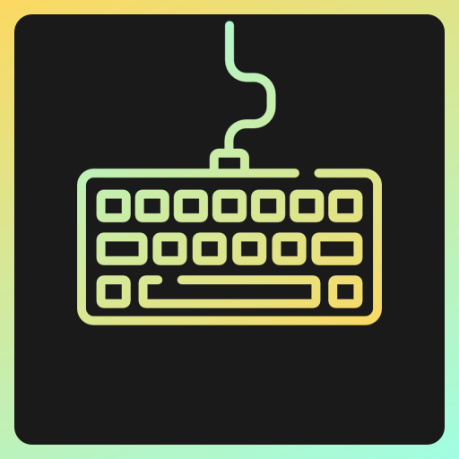
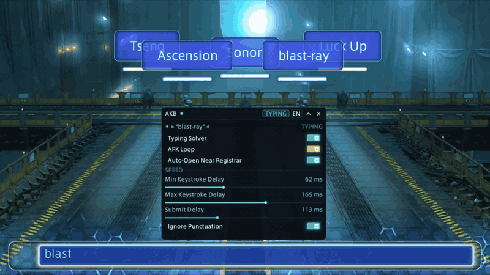

<!-- Repository Header Begin -->

  

<h1 align="center">AutoKeyboundBrawler</h1>

  

  <em>Type less. Win more. Automated typing solver for the Keybound Brawler event in FFXIV.</em>

---

  

<!-- Repository Header End -->

## Install

1. Dalamud → **Settings** → **Experimental**
2. Add custom repository: `https://raw.githubusercontent.com/1Stalk/DalamudPlugins/main/pluginmaster.json`
3. Install **AutoKeyboundBrawler** from the plugin installer

## Features

Multi-Language Support (EN / DE / FR / 日本語) · Humanized Typing · Smart Target Priority · Defense Preemption · Obstruction Safety · Obscured Word Memory · Punctuation Skip · AFK Duty Loop · Anti-AFK Kick Protection

Type `/akb` in-game to open the config panel. Toggle what you need and let the solver handle the rest.

## Multi-Language Support

AutoKeyboundBrawler seamlessly supports all official client localizations of FINAL FANTASY XIV:
- **English (EN)**: Standard QWERTY alphanumeric solver with instant defense preemption and punctuation skipping.
- **German (DE)**: Native QWERTZ support, direct OEM umlaut mapping (`ä`, `ö`, `ü`, `ß`), and localized Cactuar cast detection (`???-Stacheln`).
- **French (FR)**: Full AZERTY layout support, dead-key circumflex composing (`â`, `ê`, `î`, `ô`, `û`), digit typing via Numpad (preventing top-row `&` conflicts), typographical space trimming before punctuation (`!`, `?`), and localized Cactuar cast detection (`??? Epines`).
- **Japanese (JA)**: Native support for Japanese client phrases, reading lookup from game database (`Unknown1` hiragana readings / 振り仮名), IME Hiragana mode (`あ`), and localized Cactuar cast detection (`針？本`).

## AI Transparency

This plugin is developed under the [Dalamud AI Policy](https://dalamud.dev/plugin-publishing/ai-policy/) at the **Copilot** level. How AI is used to build this plugin is written down in [AI-USAGE.md](AI-USAGE.md).

## More from me

If you liked this plugin, take a look at my other Dalamud work. You might find something else there for you.

→ [1Stalk Dalamud Plugins](https://github.com/1Stalk/DalamudPlugins)

## License

This project is licensed under the [GNU AGPL v3](LICENSE.md).
